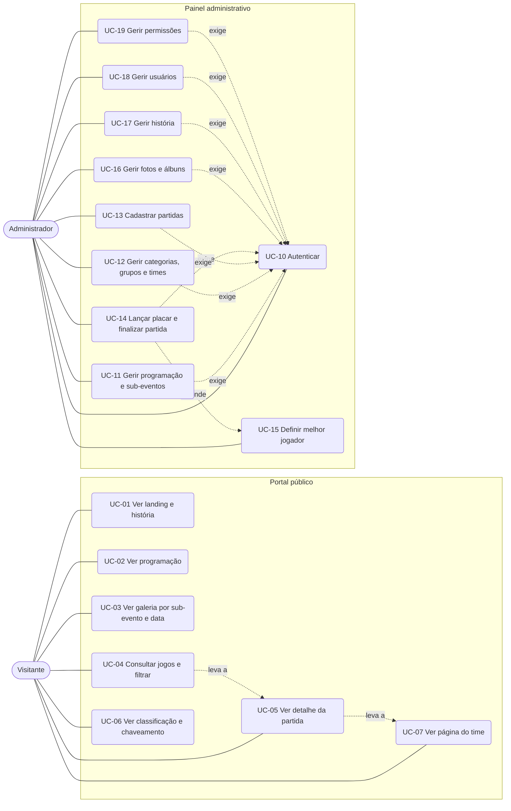

# 04 — Casos de uso

## Diagrama geral

## Especificação dos principais

### UC-14 Lançar placar e finalizar partida (fluxo crítico)
- **Ator:** Administrador (no celular, durante o jogo)
- **Pré-condição:** autenticado; partida `SCHEDULED` existente.
- **Fluxo principal:**
  1. Admin abre a lista "jogos de hoje" e escolhe a partida.
  2. Informa o placar de cada lado.
  3. Confirma "Finalizar partida".
  4. Sistema grava, marca `FINALIZED` e recalcula a classificação (RN-19).
  5. Portal público passa a exibir o resultado.
- **Alternativos:**
  - A1. Correção de partida já finalizada: reedita o placar; classificação recalculada (RN-23).
  - A2. Mata-mata empatado: sistema exige o placar dos pênaltis, que define o vencedor (RN-22, RN-24).
  - A3. Admin define o melhor jogador logo em seguida (UC-15).
- **Pós-condição:** resultado visível ao público; classificação atualizada.

### UC-05 Ver detalhe da partida
- **Ator:** Visitante
- **Fluxo:** abre a partida → vê times, placar, fase, data/local → vê melhor jogador (nome + foto) → navega pelo mural de fotos → toca em um time (UC-07).
- **Alternativo:** partida `SCHEDULED` mostra só data/local e "Em breve".

### UC-04 Consultar jogos e filtrar
- **Ator:** Visitante
- **Fluxo:** abre "Jogos" → vê abas Próximos / Finalizados → filtra por modalidade, categoria, fase, grupo e data.

### UC-03 Ver galeria por sub-evento e data
- **Ator:** Visitante
- **Fluxo:** abre "Galeria" → escolhe sub-evento → escolhe data → navega pelas fotos.

### UC-13 Cadastrar partidas
- **Ator:** Administrador
- **Fluxo:** escolhe categoria → escolhe fase (grupos/mata-mata) → seleciona dois times, data, hora, local → salva.
- **Regras:** RN-13, RN-15.

### UC-19 Gerir permissões
- **Ator:** Usuário com `user:manage-permissions` (hoje, o Admin)
- **Fluxo A (papel):** escolhe um papel → marca/desmarca permissões → salva; vale para todos os usuários do papel (RN-44).
- **Fluxo B (usuário):** escolhe um usuário → vê as permissões efetivas, com a origem de cada uma (papel, concessão) → concede ou revoga uma permissão → salva.
- **Regras:** RN-42, RN-43, RN-45, RN-46.
- **Alternativo:** tentativa de remover a permissão do último gestor de permissões é bloqueada.

Os demais (UC-01, 02, 06, 07, 10, 11, 12, 15, 16, 17, 18) são consulta ou CRUD simples e serão detalhados quando formos desenhar as telas.
