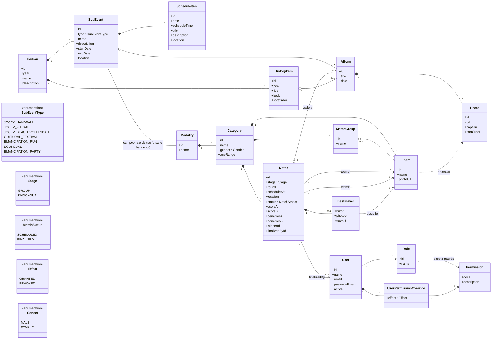

# 05 — Modelo de domínio

## Diagrama de classes

## Decisões de modelagem (para validar)
1. **`Edition` como raiz**: o evento se repete todo ano; evita refazer a estrutura em 2027.
2. **`Album` genérico**: uma única entidade de fotos serve a três usos (galeria do sub-evento por data, mural da partida, história). A galeria "por sub-evento e data" vira um álbum por sub-evento + data.
3. **Placar com pênaltis separados:** `scoreA/B` é o resultado do jogo; `penaltiesA/B` só é preenchido em mata-mata empatado. `winnerId` é derivado (gols; se empate, pênaltis) e guardado para facilitar o chaveamento.
4. **Vôlei de areia fora do modelo esportivo:** é só `SubEvent` + `Album`. Sem `Modality`, `Team` ou `Match`.
5. **Permissões como dados, não como `if (role == ...)`:** o código verifica **permissão**, nunca papel. É isso que permite o admin ajustar um usuário específico sem mexer no código.
6. **`finalizedById`:** guarda quem lançou o resultado (por isso usuário é desativado, não excluído, RN-47).
7. **`BestPlayer` é um objeto embutido na `Match`, não uma entidade `Player`.** É opcional e aponta para um dos dois times (validar `teamId` ∈ {teamA, teamB}). O cliente não quer cadastro de elenco. Se um dia vier artilharia ou elenco, ele vira entidade.
8. **Classificação não é entidade**: é calculada a partir das partidas finalizadas (RN-19). Sem risco de ficar desatualizada ou divergente.
9. **`Team` pertence a uma `Category`** (RN-13).
10. **`Modality` não vira tabela** no banco: é 1:1 com o sub-evento, então `Category` aponta direto para `SubEvent` (ver [07-modelo-dados.md](07-modelo-dados.md)).
11. **Chaveamento do mata-mata**: a primeira rodada é sugerida a partir dos times classificados (RN-27) e as rodadas seguintes são sugeridas conforme os resultados (RN-28); em ambos os casos a partida só nasce quando a organização confirma. `Match` guarda só `bracket_position`; a partida de destino é calculada pela posição, sem referência de origem por lado.

## Permissões

**Efetivas = (papel + concessões) − revogações** (RN-43). Calculadas no login/requisição, nunca gravadas.

Catálogo inicial (formato `recurso:ação`; o sistema define, ninguém cria novas):

| Permissão | Para quê |
|-----------|----------|
| `schedule:manage` | Sub-eventos e itens da programação |
| `team:manage` | Categorias, grupos e times |
| `match:create` | Criar/editar/excluir partidas |
| `match:record-score` | Lançar, corrigir e finalizar placar, pênaltis, melhor jogador |
| `photo:upload` | Enviar fotos |
| `photo:delete` | Excluir/reordenar fotos de qualquer álbum |
| `history:manage` | Linha do tempo da história |
| `user:manage` | Criar/desativar usuários |
| `user:manage-permissions` | Alterar permissões de papéis e de usuários |

**Proposta inicial por papel (a confirmar com o cliente):**

| Permissão | Admin | Gerente | Assistente |
|-----------|:-----:|:-------:|:----------:|
| `schedule:manage` | ✔ | ✔ | |
| `team:manage` | ✔ | ✔ | |
| `match:create` | ✔ | ✔ | |
| `match:record-score` | ✔ | ✔ | ✔ |
| `photo:upload` | ✔ | ✔ | ✔ |
| `photo:delete` | ✔ | ✔ | |
| `history:manage` | ✔ | ✔ | |
| `user:manage` | ✔ | | |
| `user:manage-permissions` | ✔ | | |

## Volume estimado (ordem de grandeza)
11 categorias com campeonato (7 handebol + 4 futsal); o vôlei de areia é só galeria. Com grupos e mata-mata, a edição deve ter algumas dezenas a poucas centenas de partidas, volume pequeno para qualquer banco relacional.
