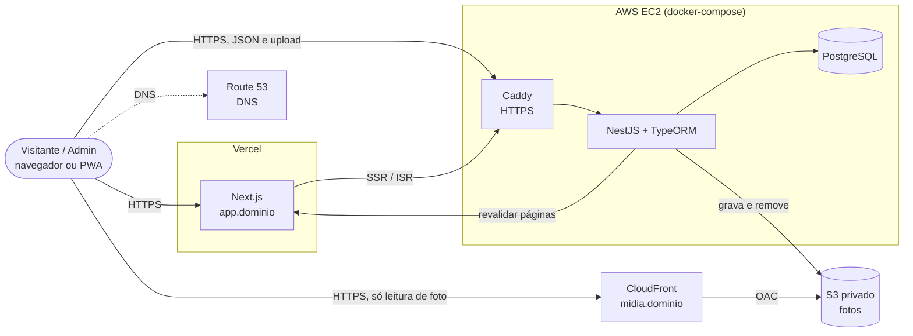

# 06 — Arquitetura

Rascunho para validar. Itens marcados **(decidir)** dependem de resposta ainda aberta.

## Visão geral


- `app.dominio` → Next.js na Vercel · `api.dominio` → API na EC2 (Caddy com certificado automático) · `midia.dominio` → fotos no S3 via CloudFront.
- Route 53 só resolve nomes: `app` aponta (CNAME) para a Vercel, `api` para o IP elástico da EC2, `midia` para o CloudFront.
- O client **nunca** fala com o banco nem grava no S3. Só chama a API (ADR-02). A leitura de foto pela URL do CloudFront é a única exceção, e é só leitura de arquivo público.
- O navegador do admin envia as fotos **direto para `api.dominio`**, sem passar pela Vercel (as funções da Vercel têm limite de corpo de ~4,5 MB, pequeno para foto de celular).
- CORS na API liberado só para `app.dominio` (e `localhost` em desenvolvimento).

## Stack
| Camada | Tecnologia | Observação |
|--------|-----------|------------|
| Front | Next.js (**App Router**, Cache Components) na **Vercel** | Já no repo. Páginas públicas com cache no servidor (`use cache`); painel admin renderizado no navegador |
| API | NestJS + **TypeORM** | Já no repo. Roda em container na EC2 |
| Banco | **PostgreSQL** em container | Mesmo `docker-compose` da API; volume persistente + backup para o S3 (ADR-04) |
| Proxy/HTTPS | Caddy em container | Certificado Let's Encrypt automático para `api.dominio` |
| Fotos | S3 + CloudFront | Bucket privado, só o CloudFront lê (OAC) |
| DNS | Route 53 | Zona hospedada + registros para app, api, midia |
| Certificados | ACM (só para o CloudFront, em us-east-1) | Vercel e Caddy emitem os seus sozinhos |

## Decisões (ADR curtos)

### ADR-01 — S3 + CloudFront + Route 53 para mídia e entrega
- **Decisão:** fotos no S3 privado, entregues pelo CloudFront no domínio `midia.<dominio>`.
- **Por quê:** barato, escala no pico dos jogos sem trabalho extra, e a CDN reduz latência em rede móvel fraca.
- **Consequência:** URLs de foto nunca mudam; ao trocar uma foto, gera-se uma chave nova (evita cache velho).

### ADR-02 — Toda conexão parte da API
- **Decisão:** o client só conversa com a API. Banco e S3 só são acessados pela API.
- **Por quê:** credenciais AWS ficam só no servidor, as permissões (RN-40 a RN-47) são aplicadas num único ponto, e dá para validar tipo e tamanho do arquivo.
- **Consequência:** o upload passa pela API (multipart) em vez de URL pré-assinada direto para o S3. Fica mais simples e seguro, mas a API recebe os bytes. Com poucos uploads simultâneos (só a equipe do painel envia, RN-32) isso é tranquilo.
- **Alternativa descartada:** URL pré-assinada (client → S3). Quebraria a regra de que a conexão parte da API.

### ADR-03 — Hospedagem: Next.js na Vercel, API + banco numa EC2 (decidido)
- **Decisão:** um `docker-compose.yml` na raiz sobe **API, PostgreSQL e Caddy** numa única EC2. O Next.js vai para a Vercel.
- **Por quê:** é o desenho mais simples e barato para um evento de ~1 mês. O ISR funciona nativamente na Vercel, que já entrega CDN e HTTPS.
- **Consequências:**
  - Sem alta disponibilidade: se a EC2 cair, o painel e os dados novos param. As páginas já geradas continuam no ar na Vercel até expirarem.
  - Plano **Hobby** da Vercel é para uso não comercial. Se o evento tiver patrocínio ou for contratado, verificar se precisa do plano Pro.
  - Segurança da EC2: Security Group abre só 80/443 (e 22 restrito ao seu IP); a porta do Postgres **não** é publicada, só a rede interna do compose enxerga o banco.
  - Usar **IP elástico**, para o registro `api` no Route 53 não mudar ao reiniciar.
- **Alternativa descartada:** ECS/App Runner (mais caro e trabalhoso para o porte).

### ADR-04 — Banco de dados: PostgreSQL em container, com TypeORM (decidido)
- **Decisão:** PostgreSQL no mesmo compose da API, dados em volume Docker (ou diretório do host) em disco EBS.
- **TypeORM:** entidades por módulo, **migrations versionadas** (`synchronize: false` em produção).
- **Backup:** `pg_dump` diário agendado (cron na EC2 ou container) enviando para um bucket S3 separado, com retenção de ~14 dias. **Testar a restauração uma vez antes do evento.** Sem RDS, esse backup é a única proteção contra perda de dados.
- **Por quê:** volume minúsculo (algumas centenas de partidas); RDS custaria mais que a EC2 inteira.

### ADR-05 — Cache e atualização do placar (sem tempo real)
- Páginas públicas (home, jogos, classificação, galeria) buscam dados **no servidor** em funções com `'use cache'`, `cacheLife` curto (ex.: minutos) como rede de segurança e `cacheTag` por assunto (`schedule`, `matches`, `standings`). A falha da API é tratada dentro do escopo de cache, com vida curta, e a parte que depende dela fica em `<Suspense>`.
- Ao **finalizar uma partida**, a API chama (com um segredo compartilhado) a rota de *on-demand revalidation* do Next na Vercel, que atualiza só as páginas afetadas (partida, time, jogos, classificação).
- Meta: resultado no ar em até ~1 min (RNF-04). Sem WebSocket e sem polling no client.
- Classificação calculada pela API na hora da requisição e cacheada. Não é gravada (RN-19).

### ADR-06 — Fotos: processamento no upload
- A API recebe a imagem, valida tipo (JPEG/PNG/WebP) e tamanho, **gera variantes** (miniatura, média, grande, em WebP) com `sharp` e grava no S3.
- Motivo: foto de celular tem vários MB; entregar o original no 4G de uma cidade do interior estraga a experiência (RNF-02).
- Chaves no S3: `photos/{albumId}/{photoId}/{variant}.webp`.
- **Não guardar o original**, só as variantes (decisão para economizar disco e custo; avisar a equipe para manter as fotos originais no celular/Drive).
- Limites: até 10 MB por foto; processamento com no máximo 2 fotos por vez para não travar a instância pequena; o painel envia as fotos de um álbum em fila.
- **Volume estimado:** ~2.500 fotos × 3 variantes (miniatura ~20 KB, média ~150 KB, grande ~500 KB ≈ 0,7 MB por foto) ≈ **1,75 GB**. Premissa: tamanhos típicos de WebP; confirmar com fotos reais. Ficam folgados no S3 e no tráfego gratuito do CloudFront.

### ADR-07 — Autenticação e autorização
- Login por e-mail e senha (hash com `scrypt`) ou por conta Google. O Google só autentica quem **já tem usuário ativo** com o mesmo e-mail (verificado pelo Google); o login não cria usuário.
- **Token de acesso** JWT de curta duração (15 min), enviado pelo client à API. **Token de renovação** opaco (7 dias), guardado na API só como hash SHA-256. Cada renovação gira o token (o antigo deixa de valer, com tolerância de 10 s para requisições paralelas); reusar um token já girado encerra a sessão inteira.
- O client guarda os dois em cookies `httpOnly`; o `proxy.ts` renova o acesso sozinho quando falta menos de 1 minuto para expirar. Usuário desativado perde o acesso na hora (a API confere o usuário a cada requisição).
- Login com Google: o client conduz o fluxo (código de autorização com PKCE, `state` e `nonce`); a API valida o `id_token` com a biblioteca oficial do Google (assinatura, emissor, público e validade).
- As **permissões efetivas** são resolvidas na API (papel + concessões − revogações) e verificadas por *guard* em cada rota (`@RequirePermission('match:record-score')`).
- O client usa a lista de permissões só para **esconder botões**; quem barra é sempre a API (RF-32).

### ADR-08 — PWA
- Manifesto + service worker (ex.: Serwist) com ícones e splash da identidade visual (ainda não fornecida).
- Estratégia: cache da casca do app e assets estáticos; **dados de jogos sempre da rede** (rede primeiro, com fallback "sem conexão"). Evita mostrar resultado desatualizado.
- Notificações push ficam **fora do MVP**.

## Estrutura de pastas sugerida
```
api/src/
  config/ database/          # variáveis de ambiente, conexão e migrations
  resources/                 # um resource por entidade (ver CLAUDE.md)
    edition/ sub-event/ category/ team/ match/ album/ photo/ history-item/
    user/ role/ auth/ health/
    <resource>/{controllers,services,repository,dto,entities,...}/ e <resource>.module.ts
client/src/
  app/              # só rotas finas e layouts (App Router)
    (public)/       # /, /jogos, /times/[id], /galeria, /historia (layout público)
    (admin)/admin/  # painel (layout neutro, renderizado no navegador)
  features/         # home, schedule, jogos, galeria, admin: components/, data/, hooks/, lib/, services/
  components/       # compartilhados: layout/, motion/ (animações), ui/
  lib/              # cliente da API, configuração, fontes
  styles/           # tokens.css e surfaces.css: identidade visual trocável (RNF-06)
```

## Riscos
| Risco | Mitigação |
|-------|-----------|
| Identidade visual atrasa | Design tokens trocáveis; construir com visual neutro |
| Pico de acesso no dia das finais | ISR na Vercel (leitura não depende da EC2) + CloudFront nas fotos; testar carga antes do dia 4/12 |
| EC2 cair no meio do evento | Alarme no CloudWatch, `restart: unless-stopped` no compose, AMI/snapshot antes do evento |
| Placar errado lançado no celular | Confirmação antes de finalizar; correção permitida (RN-23); registro de quem finalizou |
| Custo de nuvem surpresa | Alerta de orçamento no AWS Budgets; instância única e AWS Budgets com alerta |
| Perda de dados | `pg_dump` diário para o S3 + restauração testada; snapshot EBS antes do evento |
