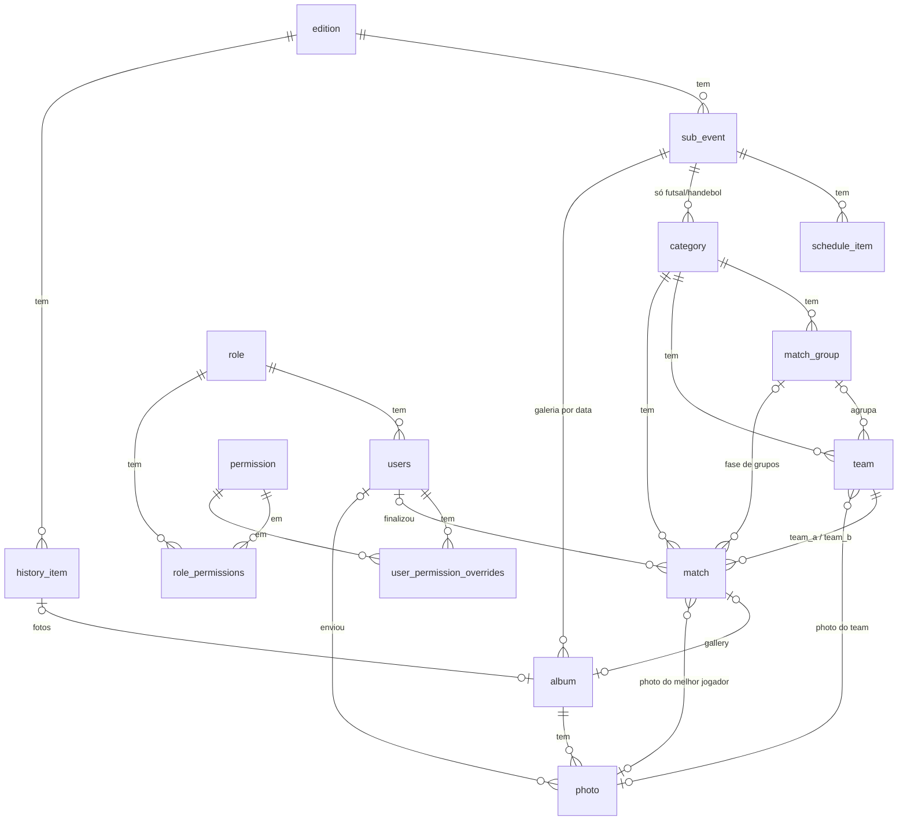

# 07 — Modelo de dados (PostgreSQL + TypeORM)

Tradução do [modelo de domínio](05-modelo-dominio.md) para tabelas. Nomes de tabela e coluna em `snake_case`; no TypeORM, entidades em inglês e `PascalCase` (`Match`, `SubEvent`) com `@Entity('match')`.

## Convenções
- **PK:** `uuid` v4 gerado pelo próprio banco (`DEFAULT gen_random_uuid()`), nunca enviado pelo client. Os IDs não são sequenciais nem adivinháveis. Nas URLs públicas do portal o time é identificado pelo `slug` (`/categorias/<categoria>/times/bairro-centro`), não pelo ID.
- **Datas:** `timestamptz` em UTC; o front formata no fuso `America/Fortaleza`. Datas sem hora (dia do sub-evento) usam `date`.
- **Enums:** `varchar` + `CHECK` (não `ENUM` nativo do Postgres), porque mudar enum nativo em migration é chato. No código, `enum` TypeScript.
- **Exclusão:** `ON DELETE RESTRICT` por padrão. Só `photo` e `schedule_item` somem em cascata junto com o pai.
- **Auditoria mínima:** `created_at` e `updated_at` em todas as tabelas de conteúdo.
- **Integridade no banco, não só no código:** as regras RN-13, RN-15, RN-18 e RN-22 viram `CHECK` e chaves estrangeiras compostas, para um bug na API não gravar partida inconsistente.

## Ajuste em relação ao modelo de domínio
**`Modalidade` deixa de ser tabela.** Ela seria 1:1 com o sub-evento (`JOCEV_HANDBALL` e `JOCEV_FUTSAL`), então `category` aponta direto para `sub_event`. Menos uma tabela e uma junção a menos nas consultas. Quem precisar do nome da modalidade lê o `type` do sub-evento.

## Diagrama ER

## Tabelas

### Estrutura do evento
| Tabela | Colunas principais | Restrições |
|--------|-------------------|-----------|
| `edition` | `id`, `year`, `name`, `description` | `UNIQUE(year)` |
| `sub_event` | `id`, `edition_id`, `type`, `name`, `description`, `start_date`, `end_date`, `location` | `UNIQUE(edition_id, type)`; `CHECK(end_date >= start_date)`; `type` ∈ RN-02 |
| `schedule_item` | `id`, `sub_event_id`, `date`, `schedule_time` (nulo), `title`, `description`, `location` | `ON DELETE CASCADE` |
| `history_item` | `id`, `edition_id`, `year`, `title`, `body`, `sort_order` | |

### Campeonato
| Tabela | Colunas principais | Restrições |
|--------|-------------------|-----------|
| `category` | `id`, `sub_event_id`, `name`, `gender`, `age_range` | `UNIQUE(sub_event_id, name)`; só aceita sub-evento `JOCEV_HANDBALL`/`JOCEV_FUTSAL` (validado na API, RN-03) |
| `match_group` | `id`, `category_id`, `name` | `UNIQUE(category_id, name)`; `UNIQUE(id, category_id)` (alvo das FKs compostas) |
| `team` | `id`, `category_id`, `group_id` (nulo), `name`, `slug`, `city`, `abbreviation` (nulo), `photo_key` (nulo) | `UNIQUE(category_id, name)`; `UNIQUE(category_id, slug)`; `UNIQUE(id, category_id)`; **FK composta `(group_id, category_id)` → `match_group(id, category_id)`** garante que o grupo é da mesma categoria (RN-13) |
| `match` | ver abaixo | ver abaixo |

**Campos do time:** `slug` é gerado do nome (`Bairro Açude` vira `bairro-acude`) quando não informado e fica estável se o nome mudar depois; `city` é obrigatória; `abbreviation` (2 a 10 caracteres) e `photo_key` (chave do arquivo, como o `storage_key` das fotos) são opcionais. `photo_key` vira FK para `photo` quando o resource de fotos existir.

**`match`**
| Coluna | Tipo | Nota |
|--------|------|------|
| `id`, `category_id` | int | |
| `stage` | varchar | `GROUP` ou `KNOCKOUT` |
| `group_id` | int, nulo | só na fase de grupos |
| `round` | varchar, nulo | só no mata-mata: `ROUND_OF_16`, `QUARTER_FINAL`, `SEMI_FINAL`, `THIRD_PLACE`, `FINAL` |
| `scheduled_at`, `location` | timestamptz, varchar | |
| `status` | varchar | `SCHEDULED` ou `FINALIZED` (`POSTPONED`/`CANCELED` só se o cliente confirmar, RN-16) |
| `team_a_id`, `team_b_id` | int | |
| `score_a`, `score_b` | smallint, nulo | preenchidos ao finalizar |
| `penalties_a`, `penalties_b` | smallint, nulo | só mata-mata empatado |
| `winner_id` | int, nulo | derivado ao finalizar; nulo em empate de grupos |
| `finalized_by_id`, `finalized_at` | int, timestamptz | quem lançou (RN-47) |
| `best_player_name` | varchar, nulo | RN-18 |
| `best_player_photo_id` | int, nulo | FK `photo` |
| `best_player_team_id` | int, nulo | deve ser `team_a_id` ou `team_b_id` |

Restrições da `match`:
- **FKs compostas** `(team_a_id, category_id)` e `(team_b_id, category_id)` → `team(id, category_id)`: os dois times são da categoria da partida (RN-15).
- `CHECK(team_a_id <> team_b_id)`.
- `CHECK((stage='GROUP' AND group_id IS NOT NULL AND round IS NULL) OR (stage='KNOCKOUT' AND group_id IS NULL AND round IS NOT NULL))`.
- `CHECK(status='SCHEDULED' OR (score_a IS NOT NULL AND score_b IS NOT NULL AND finalized_by_id IS NOT NULL))`.
- **Pênaltis (RN-22):** `CHECK(penalties_a IS NULL OR (stage='KNOCKOUT' AND score_a = score_b AND penalties_a <> penalties_b))`; `penalties_a` e `penalties_b` ambos nulos ou ambos preenchidos.
- **Melhor jogador (RN-18):** `CHECK(best_player_name IS NULL OR best_player_team_id IN (team_a_id, team_b_id))`.
- `ON DELETE RESTRICT` nos times: excluir time com partidas é bloqueado (RN-33).

> **Vencedor:** a API calcula `winner_id` ao finalizar (gols; se empatar no mata-mata, pênaltis) e recalcula ao corrigir o placar (RN-23). Fica gravado só para facilitar o chaveamento. A **classificação não é tabela** (RN-19).

### Fotos
| Tabela | Colunas principais | Restrições |
|--------|-------------------|-----------|
| `album` | `id`, `title`, `date` (nulo), `sub_event_id` (nulo), `match_id` (nulo), `history_item_id` (nulo) | **`CHECK` de exatamente um dono** entre os três; `UNIQUE(match_id)`, `UNIQUE(history_item_id)`, `UNIQUE(sub_event_id, date)` |
| `photo` | `id`, `album_id` (nulo), `storage_key`, `caption`, `sort_order`, `width`, `height`, `size_bytes`, `uploaded_by_id`, `created_at` | `ON DELETE CASCADE` a partir do álbum; índice `(album_id, sort_order)` |

- **`storage_key`** guarda o prefixo no S3 (`photos/{albumId}/{photoId}`); as URLs das variantes são montadas como `https://midia.dominio/{storage_key}/{thumb|medium|large}.webp` (ADR-06). Não se grava URL completa, para poder trocar o domínio.
- **`album_id` nulo** = foto avulsa, usada só como foto de time ou de melhor jogador.
- Ao excluir foto, a API apaga os 3 arquivos do S3; um álbum excluído em cascata exige o mesmo trabalho (a API lista as fotos antes de apagar).
- Ao trocar a foto de um time, a API grava uma foto nova e apaga a antiga (a chave muda, então não há cache velho, ADR-01).

### Usuários e permissões
| Tabela | Colunas principais | Restrições |
|--------|-------------------|-----------|
| `users` | `id`, `name`, `email`, `password_hash`, `active`, `role_id`, `created_at` | `UNIQUE(lower(email))`; nunca excluído (RN-47) |
| `role` | `id`, `code`, `name` | `UNIQUE(code)`; seed: `ADMIN`, `MANAGER`, `ASSISTANT` |
| `permission` | `code` (PK), `description` | catálogo fixo, criado por migration (RN-40) |
| `role_permissions` | `role_id`, `permission_code` | PK composta |
| `user_permission_overrides` | `user_id`, `permission_code`, `effect` (`GRANTED`/`REVOKED`) | PK composta `(user_id, permission_code)`: no máximo um efeito por permissão |

- Permissões efetivas = (papel + concedidas) − revogadas (RN-43), calculadas na API e **nunca gravadas**.
- **RN-45** (ninguém altera as próprias permissões) e **RN-46** (sempre existe um gestor de permissões ativo) são regras do serviço, não do banco, porque dependem de quem está logado e do estado de outros registros.
- **Primeiro Admin:** criado no primeiro boot a partir de variáveis de ambiente (`ADMIN_EMAIL`, `ADMIN_INITIAL_PASSWORD`) se não existir nenhum usuário. A senha nunca vai para o repositório; ela deve ser trocada no primeiro login.

## Índices além das PKs/UNIQUEs
| Índice | Para quê |
|--------|----------|
| `match(category_id, stage, scheduled_at)` | lista de jogos filtrada por categoria/fase |
| `match(status, scheduled_at)` | "próximos jogos" e "últimos resultados" da home |
| `match(team_a_id)`, `match(team_b_id)` | página do time |
| `match(group_id)` | classificação do grupo |
| `team(category_id, group_id)` | montar grupos |
| `photo(album_id, sort_order)` | galeria ordenada |

Com algumas centenas de partidas, nada disso é gargalo; os índices existem por serem baratos.

## Classificação (consulta, não tabela)
Para um grupo, considerando só partidas `FINALIZED` da fase `GROUP`: cada partida gera duas linhas (uma por time) com pontos (V=3, E=1, D=0, RN-20), gols pró e contra (W.O. vale 2x0, RN-25) e W.O. sofridos; soma-se por time e ordena por pontos e pelos critérios do edital (RN-21), isolados em `tie-break.rule.ts`. Pênaltis não entram (RN-24). Resultado cacheado pelo ISR (ADR-05).

## Migrations e seeds
- `synchronize: false`. Uma migration inicial cria o esquema; cada mudança depois é uma migration nova (`typeorm migration:generate`).
- As migrations rodam **na subida do container da API** (`migrationsRun: true`), para o deploy na EC2 ser só `docker compose up -d --build`.
- **Seed por migration:** catálogo de permissões, 3 papéis com o pacote padrão da proposta (RN-48, a confirmar) e a edição 2026 com os 7 tipos de sub-evento. As 11 categorias de RN-11 podem ir por seed ou pelo painel.
- Ambiente de desenvolvimento: um `docker-compose.override.yml` expõe a porta do Postgres só em `localhost`.

## Decisões para validar
1. **`Modalidade` removida** (explicado acima).
2. **IDs UUID v4** gerados pelo banco, em todas as tabelas (a conversão dos ids inteiros foi feita pela migration `ConvertIdsToUuid` e não tem volta).
3. **Foto de time e de melhor jogador** vivem na mesma tabela `photo`, como foto avulsa.
4. **Autenticação do MVP:** JWT de acesso com validade longa (ex.: 12 h), sem refresh token. Para um painel usado por poucas pessoas durante um mês, simplifica bastante. Contrapartida: um token vazado vale até expirar; mitigado por HTTPS e por desativar o usuário (a API confere `active` a cada requisição).
5. **Integridade pesada no banco** (FKs compostas e `CHECK`s). Custa um pouco mais de trabalho nas migrations e dá segurança extra no lançamento de placar pelo celular.

## Ordem de implementação até o MVP (4/12)
Premissa: de 21/10 a 4/12 são ~6 semanas; as estimativas abaixo são palpite para uma pessoa, a ajustar.

| # | Entrega | Depende de | Observação |
|---|---------|-----------|------------|
| 1 | `docker-compose` (Postgres + API + Caddy), TypeORM, migration inicial, deploy de teste na EC2 | — | Subir cedo reduz risco; ~1 semana |
| 2 | Auth, usuários, papéis e permissões (guards) | 1 | Tudo depois usa o `@RequirePermission` |
| 3 | Edição, sub-eventos, programação, história | 2 | CRUD simples; destrava a landing |
| 4 | Categorias, grupos, times | 3 | |
| 5 | Partidas, placar, pênaltis, melhor jogador, finalizar + classificação | 4 | **Núcleo do produto**; deixar tempo para testes |
| 6 | Fotos: upload, variantes, S3 + CloudFront, álbuns | 2 | Pode andar em paralelo ao 5 |
| 7 | Front público (home, jogos, classificação, time, galeria, história) + ISR e revalidação | 5, 6 | Visual neutro com tokens (RNF-06) |
| 8 | Painel admin (fluxo rápido de placar no celular) | 5, 6 | |
| 9 | PWA, compartilhamento, acabamento da identidade visual | 7 | P2; só se sobrar tempo |
| 10 | Teste de carga, restauração de backup, alarmes | todos | Antes de 4/12 |

**Risco principal:** a identidade visual ainda não foi entregue (RNF-06); por isso o passo 7 usa tokens neutros.
